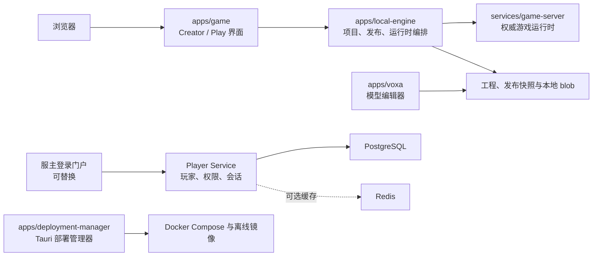

# BOX3 Engine

BOX3 Engine 是一个本地优先的体素游戏引擎发行版。它将 Creator（ARENA）、Play、VOXA、玩家身份服务、项目管理、离线资源和 Docker 部署整合在同一仓库中，可在不依赖原始云平台的情况下创建、迁移、编辑、发布和运行地图。

本仓库主要面向引擎开发者、部署维护者和发行协作者。若你是首次部署的服主，请从[安装、部署与使用手册](docs/installation-and-operations.md)开始；所有文档入口见[文档导航](docs/README.md)。

## 能力与边界

| 能力       | 当前支持                                               | 关键边界                           |
| ---------- | ------------------------------------------------------ | ---------------------------------- |
| 地图创作   | 创建、导入、编辑、预览、发布、工程备份与恢复           | Creator 只应在本机或可信局域网使用 |
| 玩家游玩   | 多地图 Play、发布快照、玩家身份、封禁与会话撤销        | Play 只读取已发布的只读快照        |
| 模型创作   | VOXA 模型、皮肤、动画和可编辑工程导入导出              | 项目内资源不自动变成全局模型库     |
| 地图迁移   | 将云端工程和资源导出为本地`.boxproject`              | 缺失 blob 会明确报告，不能凭空恢复 |
| 身份系统   | Player Service API、角色分层、封禁与服主管理           | 认证密钥只能存在于服务端           |
| 登录门户   | 提供独立参考门户，也支持服主自建                       | Creator/Play 不绑定某个登录前端    |
| 部署与发行 | Docker Compose、桌面启动器、离线包、GitHub Tag Release | PostgreSQL 由服主提供；Redis 可选  |

不包含云端工程实时同步、多人协作编辑、第三方 OAuth、公开服务器列表或 Mod 市场。Creator/ARENA 与 VOXA 不得暴露到不可信公网。

## 架构概览



Creator 保存的是可编辑工程；发布会产生不可变快照；Play 只运行快照。这是数据隔离和分发安全的基础，不能用前端隐藏功能替代。

更多模块关系、数据模型和源码定位见[系统架构与源码入口](docs/architecture.md)。

## 快速开始：开发者

### 环境要求

- Node.js `22.17.x`（见 `.node-version`）
- pnpm `10.12.1`（由 Corepack 管理）
- Docker Desktop 或 Docker Engine + Docker Compose（验证容器与生产部署时需要）
- Rust stable、平台原生工具链（仅构建 Tauri 桌面启动器时需要）

首次克隆后执行：

```bash
corepack enable
pnpm install --frozen-lockfile
pnpm check
```

`pnpm check` 是本地功能回归集合；通过后再开始改动，能避免将环境问题误判为代码问题。

### 启动一个 Creator 开发环境

```bash
pnpm dev
```

这会启动 Creator 开发运行时。网页、运行时和项目数据的实际地址由当前本地配置决定；不要手工启动内部编辑/预览端口。常用开发入口与生产容器命令见下表。

| 目标            | 开发 / 构建入口                            | 说明                                             |
| --------------- | ------------------------------------------ | ------------------------------------------------ |
| Creator / ARENA | `pnpm dev`、`pnpm creator`             | `dev` 用于源码开发；`creator` 构建并启动容器 |
| Play            | `pnpm play`                              | 启动只读游玩端，不会构建 Creator                 |
| VOXA            | `pnpm voxa:dev`、`pnpm voxa`           | 模型编辑器源码开发或容器部署                     |
| 玩家服务        | `pnpm player-service`                    | 玩家、权限、会话与服主管理                       |
| 参考登录门户    | `pnpm player-auth-portal`                | 独立示例服务，可由服主替换                       |
| 云端迁移器      | `pnpm migrator:dev`、`pnpm migrator`   | 从外部工程导出本地可编辑包                       |
| 图形化启动器    | `pnpm --dir apps/deployment-manager dev` | 仅启动 Web UI；Tauri 调试见开发者手册            |

## 快速开始：Docker 部署

生产部署前复制配置模板，并填写服主自己的 PostgreSQL 连接信息和随机密钥：

```bash
cp .env.docker.example .env
```

至少应检查：

- `BOX_DATABASE_URL`：Player Service 与持久数据使用的 PostgreSQL；
- `PERMISSION_TOKEN_SECRET`、`BOX_PLAYER_AUTH_API_KEY`、`BOX_PLAY_ADMIN_TOKEN`：使用不同的随机值；
- 各服务公开地址与端口：局域网或反向代理部署时必须同步更新；
- `BOX_PLAYER_LOGIN_URL`：服主自建登录页地址；留空时页面明确显示“未开启登录”。

不要把 `.env`、数据库密码、令牌、用户项目、备份或 Docker 卷提交到仓库。完整的配置、端口、局域网、公网和恢复步骤见[安装、部署与使用手册](docs/installation-and-operations.md)。

桌面启动器和源码 Compose 的配置来源不同：启动器要求远程 PostgreSQL 并自动维护 `.runtime.env`；源码 Compose 可选择仓库内的基础设施容器。变量含义、网络边界和修改配置后的重启规则见[配置参考](docs/configuration-reference.md)。

## 仓库地图

| 路径                          | 职责                                                       | 从这里开始的典型需求                 |
| ----------------------------- | ---------------------------------------------------------- | ------------------------------------ |
| `apps/game/`                | Creator / Play 网页、作品中心、客户端引擎                  | 页面、交互、地图/模型卡片、玩家 UI   |
| `apps/local-engine/src/`    | 项目管理、导入导出、发布、地图组、运行时生命周期、镜像脚本 | 工程、发布包、运行时和本地存储问题   |
| `services/game-server/src/` | 权威游戏运行时、编辑副本、脚本、会话、权限、存储           | 协议、脚本、地图运行、玩家与数据空间 |
| `apps/voxa/`                | 本地模型、皮肤、动画编辑器和`.voxaproject`               | 模型工程、预览、资源导入导出         |
| `apps/migrator/`            | 云端工程迁移与资源抓取                                     | 云端导入、资源缺失、迁移进度和错误   |
| `apps/deployment-manager/`  | Vite + Tauri 启动器                                        | 配置界面、Docker 控制、备份、离线包  |
| `packages/`、`internals/` | 共享协议、schema、构建、脚本 API 和基础模块                | 跨模块能力、外部兼容接口             |
| `scripts/`                  | 根级回归、离线包与静态检查                                 | 新增跨模块回归或发行校验             |
| `docs/`                     | 部署、开发、数据、认证与发行说明                           | 更新用户可见行为或协作约定           |

地图 UUID、地图组关系、blob/hash、项目快照、脚本 API 与运行时消息顺序都属于兼容接口。改动前请先阅读[与 boxes 的对齐基线](docs/boxes-parity.md)，并添加针对实际行为的回归测试。

## 关键概念

- **Map UUID**：一张地图永久不变的身份；不能用标题、目录名或玩家访问地址替代。
- **Map Group**：由一个主地图和零到多个副地图组成，共享权威资源库与组数据空间。
- **Shared Resource Library**：地图组共享的模型、皮肤、共享脚本、UI、音频和图片，不是每张地图复制一份的目录。
- **Editable Project**：Creator 可读写的工程；可导出 `.boxproject` 继续编辑。
- **Published Snapshot**：发布生成的不可变运行版本；Play 只接收它。
- **Local Model Library**：VOXA 服务器级模型库；仅当显式导入或放置时才进入项目资源范围。

术语、地图组和存储决策的完整定义见[`CONTEXT.md`](CONTEXT.md)与[系统架构](docs/architecture.md)。

## 开发与验证

### 推荐工作流

1. 先执行 `git status --short`，保护同事或使用者的未提交改动。
2. 根据需求在“仓库地图”中定位模块，阅读附近测试和模块 README。
3. 明确用户可见的成功/失败行为；涉及迁移、资源、锁或网络问题时先构造可重复的最小复现。
4. 用最小改动实现，避免顺手重构无关模块。
5. 新增 bug 回归或接口校验，格式化受影响文件。
6. 运行对应模块检查，最后运行完整门禁。
7. 同步更新 `docs/`、配置模板和发行说明。

### 常用命令

| 命令               | 用途                                             |
| ------------------ | ------------------------------------------------ |
| `pnpm check`     | 本地控制层、地图、VOXA、迁移器、启动器等回归集合 |
| `pnpm lint`      | JavaScript/TypeScript lint                       |
| `pnpm typecheck` | 当前可稳定执行的类型检查                         |
| `pnpm test`      | workspace 测试与根级检查                         |
| `pnpm verify`    | 格式、lint、类型检查和全部测试；合并与发布前必跑 |
| `pnpm format`    | 使用 Prettier 格式化整个仓库                     |
| `pnpm stop`      | 停止当前 Docker 部署，不删除持久数据             |

改动 Compose、Dockerfile 或环境变量时还应执行：

```bash
docker compose --env-file .env.docker.example config --quiet
```

更多验证矩阵、评审模板和敏感信息规则见[开发者与协作手册](docs/developer-guide.md)。

## 认证与自建登录门户

Player Service 提供认证和服主管理 API；浏览器前端不能直接持有 `BOX_PLAYER_AUTH_API_KEY` 或 `BOX_PLAY_ADMIN_TOKEN`。服主自建门户必须有服务端代理：

```text
浏览器 → 服主登录门户后端 → Player Service API → PostgreSQL
```

仓库附带的 `player-auth-portal` 是独立参考实现，适合快速测试，不应被视为不可替换的默认登录产品。接入规范、回跳白名单、Cookie 转发与安全检查见[自建登录门户接入指南](docs/self-hosted-login.md)。

## 构建与发行

推送 `v*` Tag 会触发 GitHub Actions：先执行 `pnpm verify`，再构建 `linux/amd64`、`linux/arm64` 镜像和 Windows、macOS、Linux 桌面包，最后创建 GitHub Release。

```bash
pnpm verify
git tag -a v0.1.0 -m "BOX3 Engine v0.1.0"
git push origin v0.1.0
```

自动 Release 当前适用于内部测试或明确标记为未签名的分发；Windows Authenticode、macOS Developer ID 签名和 notarization 仍需在正式公开发行流程中补充。详细的产物结构、原生构建要求、离线包校验和 CI Runner 条件见[构建、分发与 CI](docs/release-and-distribution.md)。

## 文档入口

| 主题                               | 文档                                                                                                         |
| ---------------------------------- | ------------------------------------------------------------------------------------------------------------ |
| 首次部署、配置、数据库、备份与排障 | [安装、部署与使用](docs/installation-and-operations.md)                                                       |
| 图形化启动器                       | [图形化部署管理器](docs/graphical-deployment-manager.md)                                                      |
| 环境变量、端口与网络边界           | [配置参考](docs/configuration-reference.md)                                                                   |
| 项目、发布包与地图组               | [作品与发布包](docs/projects.md)                                                                              |
| Creator、Play、VOXA 专项部署       | [创作端](docs/creator-deployment.md)、[游玩端](docs/play-deployment.md)、[VOXA](docs/voxa-deployment.md)        |
| Player Service API 与自建登录      | [认证 API](docs/player-service-api.md)、[自建登录门户](docs/self-hosted-login.md)                              |
| 协作、源码入口和兼容边界           | [开发者手册](docs/developer-guide.md)、[系统架构](docs/architecture.md)、[boxes 对齐基线](docs/boxes-parity.md) |
| 完整索引                           | [文档导航](docs/README.md)                                                                                    |

## 许可证与安全

源仓库的 npm 元数据为 `UNLICENSED`，不授予源代码开源许可。面向用户的发行包适用[BOX3 Engine 非商业本地部署最终用户许可协议](distribution/LICENSE.txt)。商业使用、二次开发、再分发或品牌合作必须取得权利人书面授权。

提交代码前请确认没有加入真实 `.env`、密码、数据库连接串、令牌、Cookie、用户 IP、日志、地图工程、模型数据、备份或 Docker 卷。
