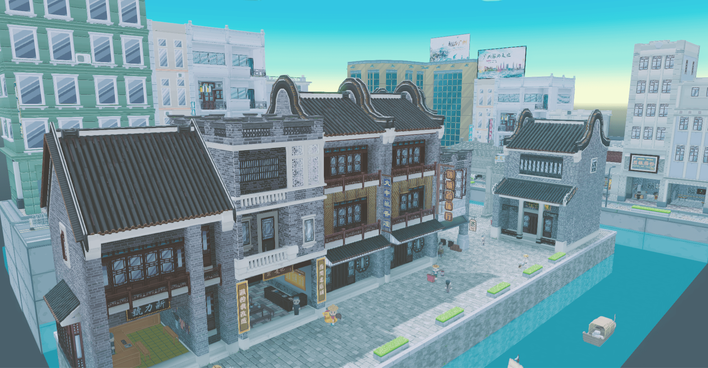
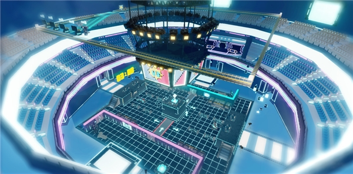
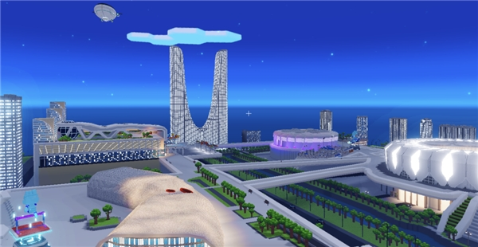

<div align="center">


# BOX3 本地引擎

[](https://nodejs.org/)
[](https://www.typescriptlang.org/)
[](https://react.dev/)
[](https://www.rust-lang.org/)
[](https://www.postgresql.org/)
[](https://redis.io/)
[](https://www.docker.com/)
[](LICENSE.md)

**网页多人 3D 创作与游玩，自主部署与管理**

</div>

## 引擎介绍

BOX3 是基于网页的多人 3D 创作与游玩工具。创作者使用 Creator 和 Arena 制作地图、用 VOXA 编辑模型，再发布给玩家通过浏览器游玩。

本地引擎将创作、游玩和管理服务部署在自己的电脑或 Linux 服务器上，由服主管理地图、玩家、访问范围和数据。

<table>
  <tr>
    <td width="50%"></td>
    <td width="50%"></td>
  </tr>
  <tr>
    <td width="50%"></td>
    <td width="50%"></td>
  </tr>
</table>

## 快速开始

需要 Node.js `22.17.x`、Docker Compose v2。仓库脚本自动准备锁定版本的 Rush 和 pnpm；原生管理器构建和完整验证还需要 Rust stable 与对应平台工具链。

```sh
git clone https://github.com/ifishcool/box-local-engine.git
cd box-local-engine
npm run install:all
cp .env.docker.example .env
npm run dev:infra
```

已有 PostgreSQL 时，配置本地 `.env` 后使用 `npm run dev`。PostgreSQL 必需，Redis 可选；不要覆盖已有配置或提交凭据。

| 服务           | 默认开发地址           |
| -------------- | ---------------------- |
| Creator        | http://127.0.0.1:3127/ |
| Play           | http://127.0.0.1:3121/ |
| VOXA           | http://127.0.0.1:3123/ |
| Player Service | http://127.0.0.1:3124/ |
| 登录门户       | http://127.0.0.1:3125/ |
| 玩家后台       | http://127.0.0.1:8000/ |

玩家后台默认随开发栈启动，发行版构建进 Player Service。玩家启动器负责连接服务器，部署管理器负责部署和维护服务，两者是不同应用。

## 项目结构

- `apps/`：编辑器、后台、启动器和本地运行适配。
- `services/`：权威游戏服务与脚本运行时。
- `packages/`、`internals/`：共享模块与内部依赖。
- `scripts/`、`common/`：仓库工具、Rush 配置与锁文件。
- `distribution/`：发行模板；`docs/`：基础入门与开发规则。

## 开发与贡献

入门命令见[开发入门](docs/developer-guide.md)，编码约定见[代码规范](docs/code-style.md)，Fork 与提交流程见[贡献指南](CONTRIBUTING.md)。API 文档可通过 `npm run api:docs` 启动。

提交前运行 `npm run verify`。源码开发不会自动更新已有容器或安装包；部署使用 [GitHub Releases](https://github.com/ifishcool/box-local-engine/releases) 中的产物。

测试构建与正式发布的分支、OSS 路径和版本约定见 [Release & Version](docs/release-and-version.md)。

不要公开数据库、Docker Socket 或管理端，不要提交密钥、用户数据、地图与备份。权限判定和权威数据必须留在服务端，不能依赖客户端隐藏按钮。

问题反馈与讨论见 [Issues](https://github.com/ifishcool/box-local-engine/issues)。第三方组件保留各自许可，项目品牌与商标不由 MIT 授权。
