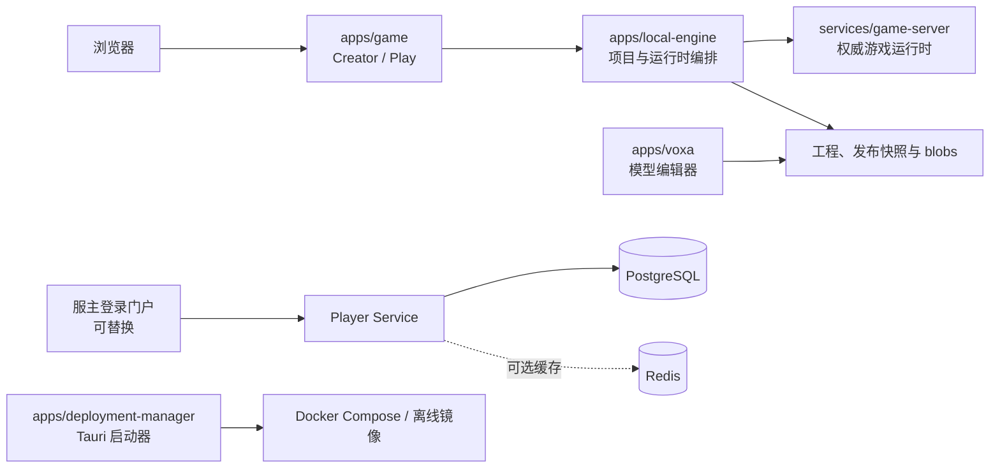

# BOX3 Engine

BOX3 Engine 是一个本地优先的体素游戏引擎发行版。它将 ARENA（Creator）、Play、VOXA、玩家身份服务、项目管理、云端迁移器和 Docker 部署整合在一个仓库中，使服主可以在不依赖原始云平台的前提下创建、迁移、编辑、发布和运行地图。

它面向三类人：**服主**部署和维护服务，**创作者**制作地图与资源，**协作者**维护引擎和发行包。按你的目标选择入口即可，不需要先读完所有文档。

| 你的目标                          | 从这里开始                                               |
| --------------------------------- | -------------------------------------------------------- |
| 在电脑或服务器上部署              | [安装、部署与运维](docs/installation-and-operations.md)  |
| 使用桌面启动器                    | [图形化部署管理器](docs/graphical-deployment-manager.md) |
| 开发、修复或评审代码              | [开发者与协作手册](docs/developer-guide.md)              |
| 构建镜像、离线包或 GitHub Release | [构建、分发与 CI](docs/release-and-distribution.md)      |
| 查找完整专题文档                  | [文档导航](docs/README.md)                               |

## 产品边界

| 能力       | 当前支持                                 | 重要边界                               |
| ---------- | ---------------------------------------- | -------------------------------------- |
| 地图创作   | 创建、导入、编辑、发布、备份与恢复       | Creator 仅限本机或可信局域网           |
| 玩家游玩   | 多地图 Play、发布快照、会话与封禁        | Play 只运行已发布的只读快照            |
| 模型创作   | VOXA 模型、皮肤、动画与工程导入导出      | Local 模型只有放入地图后才属于 Project |
| 地图迁移   | 云端工程导出为本地 `.boxproject`         | 缺失 blob 会明确报错，不能凭空恢复     |
| 身份系统   | Player Service API、角色、封禁与会话撤销 | 密钥只能存在于服务端                   |
| 登录门户   | 参考实现与完整 API                       | 服主可以替换为自己的门户               |
| 部署与发行 | Compose、桌面启动器、离线包、Tag Release | PostgreSQL 由服主提供；Redis 可选      |

不包含云端实时协作编辑、第三方 OAuth、公开服务器列表、商城、支付、Mod 市场或平台分析。Creator/ARENA 与 VOXA 不得暴露到不可信公网。

## 架构一览



Creator 保存可编辑工程；发布会生成不可变快照；Play 只运行快照。这是数据隔离与可复现发布的基础。完整数据流、术语和代码定位见[系统架构与源码入口](docs/architecture.md)。

## 快速开始

### 开发者

要求：Node.js `22.17.x`、pnpm `10.12.1`（Corepack）、Docker Compose；构建桌面启动器另需 Rust stable 与对应原生工具链。

```bash
corepack enable
pnpm install --frozen-lockfile
pnpm check
```

常用入口：

| 目标                       | 命令                                                                          |
| -------------------------- | ----------------------------------------------------------------------------- |
| Creator 开发运行时         | `pnpm dev`                                                                    |
| Creator / Play / VOXA 容器 | `pnpm creator` / `pnpm play` / `pnpm voxa`                                    |
| VOXA 或迁移器源码开发      | `pnpm --filter @box-local/voxa dev` / `pnpm --filter @box-local/migrator dev` |
| 图形化启动器 Web UI        | `pnpm --dir apps/deployment-manager dev`                                      |
| 完整门禁                   | `pnpm verify`                                                                 |

### Docker / 源码部署

复制配置模板后填写 PostgreSQL 和随机密钥：

```bash
cp .env.docker.example .env
```

至少检查 `BOX_DATABASE_URL`、三项服务端密钥、各公开地址/端口，以及 `BOX_PLAYER_LOGIN_URL`。不要提交 `.env`、令牌、数据库连接串、用户项目、备份或 Docker 卷。具体配置、局域网/公网边界、备份和排障请按[安装、部署与运维](docs/installation-and-operations.md)操作。

## 源码导航

| 路径                        | 职责                                         | 典型需求                   |
| --------------------------- | -------------------------------------------- | -------------------------- |
| `apps/game/`                | Creator / Play Web 与客户端引擎              | 页面、交互、作品与玩家 UI  |
| `apps/local-engine/src/`    | 项目、发布、导入导出、地图组与运行时生命周期 | 工程、发布包、存储问题     |
| `services/game-server/src/` | 权威运行时、编辑副本、脚本、会话与数据空间   | 协议、脚本、地图运行       |
| `apps/voxa/`                | 模型、皮肤、动画编辑器                       | 模型工程与资源导入导出     |
| `apps/migrator/`            | 云端工程迁移与资源抓取                       | 云端导入、资源缺失与进度   |
| `apps/deployment-manager/`  | Vite + Tauri 桌面启动器                      | 配置、Docker、备份与离线包 |
| `packages/`、`internals/`   | 共享协议、schema、构建与脚本 API             | 跨模块兼容接口             |
| `scripts/`                  | 根级回归、发行和静态检查                     | 自动化验证                 |

地图 UUID、地图组、资源 hash、脚本 API、发布快照和 MuDB 消息顺序都是兼容接口。修改前先阅读[与 boxes 的对齐基线](docs/boxes-parity.md)，并为实际行为补回归测试。

## 协作与验证

每次改动建议遵循：确认工作树 → 定位模块与现有测试 → 明确可观察行为 → 最小实现 → 增加回归 → 格式化 → 模块检查 → `pnpm verify` → 同步文档。

```bash
git status --short
pnpm format:check
pnpm lint
pnpm typecheck
pnpm test
pnpm verify
```

改 Compose、Dockerfile 或环境变量时额外执行：

```bash
docker compose --env-file .env.docker.example config --quiet
```

更细的验证矩阵、提交要求、安全规则和本项目/boxes 的边界见[开发者与协作手册](docs/developer-guide.md)与[工程开发规范](docs/engineering.md)。

## 发行

推送 `v*` Tag 会触发 GitHub Actions：验证源码，构建 `linux/amd64` 与 `linux/arm64` 的五项服务镜像，为各桌面目标生成匹配标签的离线归档，最后构建 Windows、macOS、Linux 启动器并创建 GitHub Release。

```bash
pnpm verify
git tag -a v0.1.0 -m "BOX3 Engine v0.1.0"
git push origin v0.1.0
```

自动 Release 用于内部测试或明确标识的未签名分发。Windows Authenticode、macOS Developer ID 签名和 notarization 是正式公开发行的额外步骤，详见[构建、分发与 CI](docs/release-and-distribution.md)。

## 许可证与安全

源仓库的 npm 元数据为 `UNLICENSED`，不授予源代码开源许可。面向用户的发行包适用[BOX3 Engine 非商业本地部署最终用户许可协议](distribution/LICENSE.txt)。商业使用、二次开发、再分发或品牌合作必须取得权利人书面授权。

提交代码前确认没有加入真实 `.env`、密码、令牌、Cookie、用户 IP、日志、地图工程、模型数据、备份或 Docker 卷。
