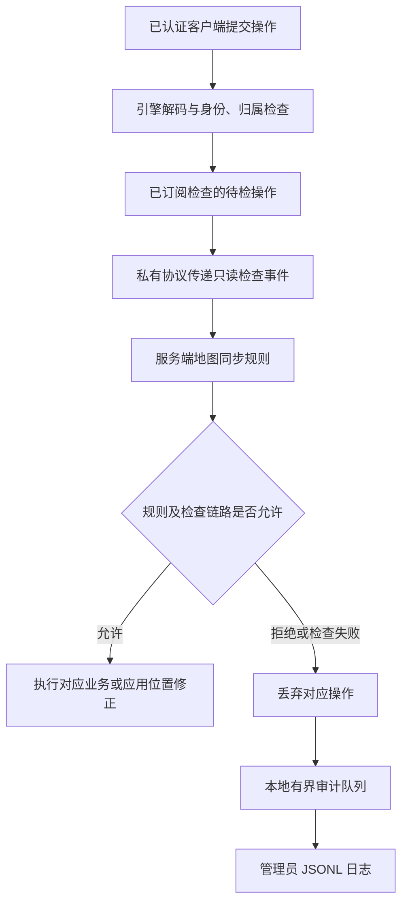

# 本地引擎反作弊 API 详细设计书

> 历史技术/验收记录：结论只对应文中日期、源码和测试环境，不表示当前版本全量验收通过。当前状态见[版本说明](./current-status.md)。本机原始报告与候选包不随源码分发。

> 编写日期：2026-10-06  
> 对应版本：本地引擎 0.3.0
> 文档范围：服务端 `world.anticheat` API、地图规则辅助模块、本地审计及已完成测试

## 1. 项目结论与建设价值

本次实现提供了“客户端操作进入业务前，由服务端检查并决定是否执行”的反作弊能力。地图开发者可以检查移动修正、攻击、连续输入、键盘、交互、自定义消息及界面事件，并记录玩家行为、累计异常分数和设置合法技能的临时豁免。

核心价值是把操作的最终决策留在服务端：客户端可以提交候选数据，但不能通过自报账号、目标、位置或时间，替代服务器的身份和玩法校验。拒绝记录能够关联认证账号、显示名、地图及原因，支持管理员追溯。

**截至本次验证，55 项反作弊自动化测试全部通过；新版 Creator 的真实浏览器对照验证了正常消息放行、指定异常消息拒绝、真实账号身份写入审计。当前交付物为发行候选，正式地图的多人、延迟与武器结算等验收仍待完成。**

| 已具备能力 | 对项目的作用 | 使用条件 |
| --- | --- | --- |
| 操作执行前检查和拒绝 | 阻止指定异常操作进入业务处理 | 地图接入同步规则 |
| 服务端可信玩家身份 | 防止客户端冒用他人账号作为事件主体 | 使用引擎认证连接 |
| 移动与攻击分类事件 | 开发者直接按玩法编写规则 | 校准移动、技能、武器参数 |
| 有界历史、异常分数、临时豁免 | 支持连续行为分析，兼顾合法技能 | 地图主动调用记录器 |
| 本地拒绝审计 | 追溯谁、何时、在哪张地图、因何被拒绝 | 本地 Creator / Play 自动启用 |
| 异常处理和容量保护 | 脚本失效时拒绝待检操作，限制积压 | 已启用相应检查链路 |

引擎不自动给所有地图套用固定速度阈值，不改变重力，也不自动封号或封 IP。地图仍保留自己的正常移动、飞行、技能和业务行为；是否异常由服务端玩法规则决定。

## 2. 设计目标与能力边界

### 2.1 设计目标

1. 在客户端候选位置、攻击或业务消息产生实际效果之前提供检查入口。
2. 事件玩家身份来自服务器，隔离客户端自报身份和候选内容。
3. 提供易于接入的分类 API，同时保留高级全消息检查入口。
4. 支持按玩家、按规则独立保存历史、分数及临时豁免。
5. 拒绝、故障及审计均有明确语义，避免把运行时故障误报为作弊。
6. 限制等待队列、历史和日志空间，控制异常流量造成的资源占用。
7. 兼容旧版无参数 `reject()`，在编辑器、SDK 与服务端保持类型一致。

### 2.2 适用与不保证的场景

| 场景 | 当前设计如何处理 | 边界 |
| --- | --- | --- |
| 大幅瞬移、异常位置修正 | 对比服务端位置与客户端候选位置 | 合法传送、网络抖动要单独处理 |
| 异常速度、飞行、空中加速、取消击退 | 结合速度上限及速度修正差检查 | 参数必须匹配该地图的物理和技能 |
| 单包堆叠攻击、跨包高频攻击 | 动作数量和服务端冷却检查 | 合法自动武器需要自己的冷却模型 |
| 伪造远距离目标、射线起点和方块命中 | 服务端解析目标并重新射线查询 | 默认辅助函数没有历史回放补偿 |
| 自定义消息、按钮事件越权 | 校验消息结构、状态和权限 | 权限、金额、背包等仍由业务服务端判断 |
| 客户端改他人实体位置、重复自身修正 | 引擎归属和一致性检查 | 客户端本地视觉变化不等于服务器被修改 |
| 透视、Tracer、相机/FOV 修改 | 需要配合信息下发和可见性策略 | 当前 API 不能阻止用户修改本地渲染 |
| 自动瞄准、合法速率内自动点击 | 可扩展行为分析规则 | 当前阈值与射线校验不能保证识别 |

## 3. 总体架构与判定流程



地图通过事件订阅开启相应检查。未订阅的类别维持原有业务路径，仍受引擎已有身份、归属和协议检查约束。已开启的检查通过私有宿主协议向服务端脚本发送样本；客户端不能直接批准私有判定。

### 3.1 三类数据的可信程度

| 数据 | 来源 | 使用原则 |
| --- | --- | --- |
| `event.player`、审计 `userId/name` | 服务端实体映射和认证连接 | 用于确定操作主体；不采用载荷自报账号 |
| `serverPosition`、移动 `from`、服务端 tick | 服务端当前状态或处理快照 | 用作检查基准；不等于历史物理回放 |
| 客户端位置、速度、输入 tick、射线、目标 ID | 客户端候选数据 | 必须按服务端规则复核 |

### 3.2 通用判定约定

- 监听器必须同步完成，不能使用 `async`、`await` 或返回 Promise。
- 当前同步回调内调用 `event.context.reject(reason)` 即拒绝；不调用表示本监听器允许继续。
- 多个监听器中任意一个拒绝，当前检查结果即为拒绝。没有可撤销其他监听器拒绝的 `approve()`。
- 监听器抛异常、返回 Promise、检查超时或脚本不可用时，待检操作按失败拒绝处理。
- `reject()` 只影响对应操作，不自动踢出、封禁或处罚玩家。
- 判定监听器避免直接发放奖励、扣血或修改背包。另一监听器仍可能拒绝同一包，业务效果应在最终通过后的正式业务回调中产生。
- 脚本重启期间，已开启的检查有恢复保护；不能将失去脚本连接当成自动关闭保护。

### 3.3 拒绝粒度

| 接口 | 拒绝影响 |
| --- | --- |
| `onMovement` | 本次客户端位置/速度修正不应用；移动控制仍保留 |
| `onAction`、`onInput`、`onKeyboard` | 拒绝承载该事件的整条输入消息，可能同时丢弃其中移动控制 |
| `onInteract`、`onCustomEvent`、`onUIEvent` | 拒绝承载该事件的业务消息 |
| `onMessage` | 拒绝当前协议消息的业务处理 |

## 4. API 总览

入口为服务端脚本的 `world.anticheat`。这些检查 API 不向客户端开放。

| API | 用途 | 典型使用场景 |
| --- | --- | --- |
| `onMovement(handler)` | 检查客户端位置和速度修正 | 瞬移、异常加速、空中加速、抗击退 |
| `onAction(handler)` | 检查逐次主/副操作 | 攻击冷却、堆叠操作、目标距离及遮挡 |
| `onInput(handler)` | 检查连续控制按钮状态 | 按玩法限制飞行、奔跑或二段跳 |
| `onKeyboard(handler)` | 检查按下/松开的键码列表 | 自定义按键协议与状态约束 |
| `onInteract(handler)` | 检查候选实体交互 | 远程交互、交互对象权限 |
| `onCustomEvent(handler)` | 检查客户端脚本自定义消息 | 购买、技能、装备等自定义协议 |
| `onUIEvent(handler)` | 检查自定义界面事件 | 按钮、表单及菜单操作校验 |
| `onMessage(handler)` | 检查已认证玩家的全部游戏协议消息 | 高级协议审查、统一消息规则 |
| `createTracker(options?)` | 创建独立规则记录器 | 有界历史、异常评分、临时豁免 |
| `event.context.reject(reason?)` | 拒绝当前操作并提供原因 | 同步规则发现异常时调用 |

八个事件订阅接口均返回 `GameEventHandlerToken`，供取消、恢复和查询订阅状态。

## 5. 通用类型与订阅管理

### 5.1 事件上下文 `context`

| 字段/方法 | 类型 | 用途 |
| --- | --- | --- |
| `source` | `'client-message'` 或 `'client-correction'` | 区分业务消息与位置修正 |
| `serverTick` | `number` | 服务端处理样本的 tick，用于排序和追溯 |
| `mode` | `'edit' \| 'play'` | 区分编辑运行与正式游玩 |
| `inputTick` | `number`，仅移动上下文 | 客户端输入 tick；不能作为可信时间 |
| `reject(reason?)` | `(reason?: string) => void` | 在当前同步回调中拒绝 |

`reject()` 不传原因或传空字符串时使用 `map-rule`。有效原因最多保留 128 个字符，审计会清理控制字符。建议使用稳定、简短的原因代码，例如 `action-cooldown`、`position-error`、`permission-denied`。不要在原因中放密码、token 或消息正文。

回调结束后调用 `reject()` 不会改变已完成判定。多个拒绝或故障可能覆盖最终原因，因此单条审计原因不代表本次所有规则的完整判断过程。

### 5.2 订阅 token 的全部方法

| 方法 | 返回值 | 用途 |
| --- | --- | --- |
| `token.cancel()` | `void` | 取消该次注册的监听器 |
| `token.resume()` | `void` | 恢复该监听器 |
| `token.active()` | `boolean` | 查询当前是否处于监听状态 |

```js
const token = world.anticheat.onCustomEvent(event => {
  // 在此同步校验自定义协议。
});
// 地图规则卸载时：
token.cancel();
// 需要重新启用时：
token.resume();
```

每次注册有独立 token。安装规则时应保存 token，卸载或重复安装前取消旧监听，避免同一操作被重复计分。

### 5.3 数据类型

`MovementPosition` 为只读 `{ x: number, y: number, z: number }`。

`ClientMessageData` 为 JSON 数据：`null`、布尔、有限数字、字符串、数组或键值对象。事件快照为只读数据；应记录必要字段，不保存整个玩家、实体或上下文对象。

## 6. 八类检查事件详细设计

### 6.1 `onMovement`：位置与速度修正检查

**用途：** 在客户端候选位置/速度应用前检查偏差，支持瞬移、异常速度及取消服务端击退等规则。

```ts
world.anticheat.onMovement(handler: (event: GameMovementEvent) => void)
```

| 字段 | 含义及用法 |
| --- | --- |
| `player` | 服务端识别的玩家 |
| `from` | 服务器认可的位置快照 |
| `to` | 客户端候选位置，尚未应用 |
| `velocity.from` | 服务端当前速度 |
| `velocity.to` | 客户端候选速度 |
| `elapsedMs` | 两次服务器处理采样的间隔，不是物理模拟 dt |
| `context` | 移动修正来源、输入 tick、服务端 tick、运行模式和拒绝方法 |

服务端脚本直接传送不触发本事件。速度数值使用引擎物理单位，不能直接当作“米/秒”。不得仅按 `elapsedMs` 推算允许位移，长时间不发包不能成为大幅瞬移的许可。

仅检查位置差会漏掉“位置不变但速度被修改”的样本，应同时考虑速度上限和修正差。合法击退、冲刺、载具及技能通过服务端 profile 或短期豁免处理。

### 6.2 `onAction`：逐次主/副操作检查

**用途：** 检查点击、攻击、放置等离散操作，支持堆叠攻击、跨包冷却和命中复核。它与连续按钮状态检查不同。

| 事件字段 | 含义 |
| --- | --- |
| `player` | 服务端操作主体 |
| `serverPosition` | 服务端脚本当前认可的玩家实体位置 |
| `actions` | 本输入消息所有主/副操作变化，含按下和松开，重复操作不合并 |
| `context` | 消息上下文；拒绝会丢弃整条输入消息 |

每个 `GameAnticheatAction` 包含：

| 动作字段 | 含义及校验要求 |
| --- | --- |
| `tick` | 客户端输入 tick，不作为冷却权威时钟 |
| `button` | `'action0'` 或 `'action1'` |
| `pressed` | 根据客户端前后状态计算的按下/松开变化，不证明真实物理按键 |
| `position` | 客户端自报玩家位置；检查基准使用 `serverPosition` |
| `targetId` | 客户端声称的目标 ID；0 表示未指定实体 |
| `target` | 由服务端实体表解析的候选实体；未知或未指定时为 `undefined` |
| `ray.origin` | 客户端候选射线起点，要核对服务端相机/武器位置 |
| `ray.direction` | 客户端候选方向，要检查合法性并在服务端复核命中 |
| `ray.normal` | 客户端候选命中法线 |
| `ray.voxel` | 客户端候选命中方块坐标 |
| `ray.distance` | 客户端候选距离；负值表示未声明命中 |

目标能够解析不等于目标合法，更不等于伤害已经命中。服务器需要重新检查距离、遮挡、武器、弹药及权限。射线校验通过后，伤害结算仍由正式业务逻辑完成。

### 6.3 `onInput`：连续控制状态检查

**用途：** 检查跳跃、奔跑、飞行等连续控制意图。

字段：`player`、客户端 `tick`、`buttons`、消息 `context`。

`buttons` 为只读布尔对象，包含 `jump`、`walk`、`crouch`、`run`、`fly`、`doubleJump`、`action0`、`action1`。

例如地图可以在服务端角色状态禁止飞行时拒绝带 `fly` 的输入。飞行合法性应由该地图的权限、技能和玩法状态决定；订阅本接口本身不会禁止飞行或改变重力。

### 6.4 `onKeyboard`：按键变化检查

**用途：** 审查客户端提交的键码列表，支持自定义键盘协议校验。

字段：`player`、客户端 `tick`、`pressed: readonly number[]`、`released: readonly number[]`、消息 `context`。

这些列表是客户端上报的数据，不能证明用户确实按下了物理键盘。若同一输入包还含其他控制，拒绝会影响整包，应控制规则范围。

### 6.5 `onInteract`：实体交互检查

**用途：** 在交互业务前校验对象、距离、可见性及角色权限。

字段：`player`、客户端 `tick`、`target: GameEntity | undefined`、消息 `context`。

候选目标由服务端实体表解析。未知目标要按玩法明确拒绝或忽略；目标存在仍需核对是否可交互，例如玩家与宝箱的距离、门的归属、任务状态。

### 6.6 `onCustomEvent`：客户端脚本自定义消息检查

**用途：** 检查客户端通过 `remoteChannel` 发来的已解析 JSON 业务数据。

字段：`player`、客户端 `tick`、只读 `data: ClientMessageData`、消息 `context`。

用于购买、装备、技能等自定义协议。服务端应自行取得余额、背包与权限，不能直接相信 `data.userId`、金额或“技能已通过”等自报字段。仅识别消息名称也不足以授权业务。

### 6.7 `onUIEvent`：自定义界面事件检查

**用途：** 校验自定义 GUI 按钮、表单和菜单发出的事件。

字段：`player`、`name: string`、只读 `data: ClientMessageData`、消息 `context`。

适合检查事件名是否属于允许集合、字段是否合法、玩家当前是否有权操作。与 UI 相关的属性回复身份和旧脚本句柄问题，还由引擎底层协议检查处理。

### 6.8 `onMessage`：全部游戏协议消息检查

**用途：** 为高级规则提供统一的业务处理前检查入口。

| 字段 | 含义 |
| --- | --- |
| `player` | 已认证玩家 |
| `protocol` | 引擎注册的协议名，非客户端自报字符串 |
| `message` | 引擎注册的消息名 |
| `data` | 解码后的只读副本；敏感字段遮蔽，原始二进制只提供长度信息 |
| `unreliable` | 是否通过不可靠消息通道传递 |
| `context` | 当前消息的判定上下文 |

普通移动或攻击规则优先使用对应分类事件。全消息监听覆盖范围更广，应明确协议筛选条件，避免误拒绝网络维护或正常界面回复。仅订阅一个类别不会让所有无关消息都等待该规则。

## 7. 规则记录器 `createTracker` 详细设计

### 7.1 创建及参数

```ts
const tracker = world.anticheat.createTracker({
  historySize: 32,
  decayPerTick: 0,
});
```

| 参数 | 默认值 | 约束与用途 |
| --- | --- | --- |
| `historySize` | 32 | 每位玩家最新记录容量，整数 1～256；不是玩法阈值 |
| `decayPerTick` | 0 | 每个服务端脚本 tick 扣减的分数，非负有限数；0 表示不衰减 |

每个脚本最多创建 64 个记录器。实例之间的历史、分数和豁免独立。它不会自动订阅事件、采集样本、拒绝操作、写入宿主持久审计或处罚。

### 7.2 记录器全部属性和方法

| API | 返回值 | 用途与行为 |
| --- | --- | --- |
| `serverTick` | `number` | 当前服务端脚本 tick；时钟回退不会使记录器时间倒退 |
| `record(player, data)` | `GameAnticheatHistoryEntry` | 主动保存一条 JSON 只读快照，服务端写入时间；超过容量淘汰最旧记录 |
| `getHistory(player)` | 只读记录数组 | 按时间顺序返回当前保留样本；无记录时为空数组 |
| `addScore(player, amount)` | `number` | 在当前衰减后分数上累加并返回新分数；只接受非负有限数 |
| `getScore(player)` | `number` | 根据服务端时间计算衰减后的分数，最低为 0；无分数时为 0 |
| `resetScore(player)` | `void` | 只清除分数，保留历史和豁免 |
| `exempt(player, { ticks, reason? })` | `void` | 设置本规则临时豁免标记，`ticks` 必须是正安全整数 |
| `isExempt(player)` | `boolean` | 查询有效豁免；规则自行决定是否跳过检查 |
| `getExemption(player)` | 豁免对象或 `undefined` | 读取有效豁免，过期会删除 |
| `clearExemption(player)` | `void` | 主动结束该规则的豁免 |
| `clear(player?)` | `void` | 传玩家时清空该玩家全部历史、分数、豁免；不传时清空整个实例 |

`GameAnticheatHistoryEntry` 包含 `serverTick` 和 `data`。`GameAnticheatExemption` 包含 `untilTick` 和 `reason`。豁免原因最多 256 字符，到达 `untilTick` 时失效。

记录器按服务端脚本 tick 计算，不能把 tick 直接当毫秒。客户端改变输入 tick 不会改变服务器冷却、分数衰减或豁免期限。重新设置豁免会替换该玩家的原标记。

### 7.3 记录安全与生命周期

记录仅接受有限数值和普通 JSON 数据，不接受玩家/实体类实例、循环引用、getter/setter、稀疏数组等。当前快照限制包括：最多 2,048 个节点、嵌套深度最多 16、JSON 序列化结果最多 16,384 个字符。

历史属于脚本内存状态，脚本初始化时清空，不作为长期审计数据库。玩家离开时建议主动 `clear(player)`；卸载规则时取消 token 并清空记录器。

豁免只是本规则的标记，不会跳过引擎身份、实体归属或消息一致性检查。应只在服务端确认合法传送、击退或技能后设置，不能由客户端直接请求取得豁免。

## 8. 接入示例与地图规则辅助模块

### 8.1 最小接入示例

以下为文档内示例，用于说明调用方式；不会自动安装到任何地图。示例业务名需替换为地图真实协议。

```js
const tracker = world.anticheat.createTracker({ historySize: 32 });
const token = world.anticheat.onCustomEvent(event => {
  const data = event.data;
  if (!data || typeof data !== 'object' || Array.isArray(data)) return;
  if (data.kind !== 'equip-item') return;

  tracker.record(event.player, { kind: data.kind });
  if (typeof data.itemId !== 'string') {
    tracker.addScore(event.player, 1);
    event.context.reject('invalid-item-id');
  }
  // 正式业务处理仍须校验：该认证玩家是否拥有此物品、当前是否允许装备。
});

// 卸载规则时调用：
function disposeRule() {
  token.cancel();
  tracker.clear();
}
```

### 8.2 可配置辅助模块的定位

仓库提供 `docs/examples/anticheat-policy.js`，其中 `installMapAnticheat` 和 `validateAnticheatRay` 是地图辅助函数，**不是 `world.anticheat` 新增成员**。它们需要由开发者合并到地图服务端代码并提供玩法参数。

| 辅助接口 | 用途 |
| --- | --- |
| `installMapAnticheat(world, options)` | 安装移动/动作规则，管理玩家状态、冷却和订阅 |
| 返回值 `movementTracker` | 移动规则独立历史与分数 |
| 返回值 `actionTracker` | 动作规则独立历史与分数 |
| 返回值 `exemptMovement(player, ticks, reason)` | 只设置移动规则的临时豁免 |
| 返回值 `dispose()` | 取消订阅，清空玩家映射和记录 |
| `validateAnticheatRay(world, action, spec)` | 用当前服务端世界重新查询实体/方块命中，返回 `null` 或拒绝原因 |

### 8.3 安装配置的全部字段

| 配置 | 用途 |
| --- | --- |
| `observeOnly` | 默认 `true`；异常记录和计分，设为 `false` 才执行规则拒绝 |
| `historySize` | 辅助模块记录容量，默认 64，仍受记录器上限约束 |
| `spawnGraceTicks` | 初始移动同步豁免，默认 0；不豁免攻击 |
| `entities` | 安装到运行中地图时传入已有服务端玩家实体，默认空集合 |
| `movement` | 启用移动规则；需提供 `limits(entity, event)` |
| `action` | 启用动作规则；需提供起点容差、次数、冷却和 validator |
| `onDecision` | 可选同步统计回调 `{ player, kind, reason, rejected }`，不得等待数据库 |

至少启用移动或动作其中一类。`observeOnly` 仅改变该辅助规则的主动拒绝行为；无效配置、异步 validator 和监听器故障仍可能触发引擎失败拒绝。

`movement.limits(entity, event)` 同步返回六个非负有限值：

| 字段 | 用途 |
| --- | --- |
| `positionError` | 客户端候选位置与服务端位置的最大容差 |
| `horizontalSpeed` | 当前合法水平速度上限 |
| `riseSpeed` | 合法上升速度上限 |
| `fallSpeed` | 合法下落速度绝对值上限 |
| `horizontalVelocityError` | 合法水平速度修正差 |
| `verticalVelocityError` | 合法竖直速度修正差 |

`action` 配置包含：`originRadius`（射线起点距服务端实体位置的容差）、`maxPresses`（单包按下次数上限）、`cooldownTicks.action0/action1`（独立冷却）、`validate(event, action, entity)`（同步返回 `null` 或原因字符串）。

冷却由服务端脚本时钟计算，按玩家、按钮分别保存；松开不消耗冷却。辅助模块只在整包通过自身规则后提交新冷却，被自身拒绝的包不污染下一次正常操作；其他监听器仍可能拒绝，因此该结果不代表最终伤害已经生效。

`validateAnticheatRay` 的 `spec` 包含服务端 `origin`、正有限 `maxDistance` 和可选 `ignoreSelector`。它归一化候选方向，在服务端查询首个命中；实体目标要与查询结果相同，方块命中坐标也要一致。没有声明命中的空击可以通过，真实伤害仍由业务确认。

该函数使用当前世界快照，没有延迟补偿或历史回放。第三人称相机、移动目标、方块边缘与高延迟需要专门校准。

## 9. 拒绝审计与身份追溯设计

### 9.1 如何记录“是谁”

宿主从认证连接的 `user.id` 与 `user.displayname` 取得账号和显示名，并记录本次玩家 ID。客户端载荷中的自报 `userId` 不参与身份确定。日志可以证明哪个认证账号的操作被拒绝；它不能单独证明该账号已经作弊，也不等于识别现实中的个人。

### 9.2 存储与字段

本地 Creator、Play 自动将审计写入运行时挂载的 `apps/local-engine/data/anticheat-audit/`。其他宿主需显式配置 `BOX_ANTICHEAT_AUDIT_PATH`。命名空间目录名为 `BOX_DATA_STORAGE_NAMESPACE` 的 SHA-256 前 24 位。

| 字段 | 含义 |
| --- | --- |
| `version` | 记录结构版本，当前为 1 |
| `time` | 宿主生成的 ISO 时间 |
| `mapId`、`mode` | 地图标识与编辑/游玩模式 |
| `userId`、`name` | 认证账号 ID 和显示名；身份不可取得时可为 `null` |
| `playerId` | 本次运行时玩家 ID |
| `kind` | `movement` 或 `message` |
| `classification` | 疑似异常或检查故障 |
| `reason` | 最终拒绝原因 |
| `serverTick` | 服务端处理 tick |
| 移动扩展字段 | `inputTick`、`from`、`to`、`velocity` |
| 消息扩展字段 | `protocol`、`message`；不存原始消息正文 |

审计只记录该检查链路的拒绝，不是所有玩家行为的完整流水。观察模式下只记分的异常不会自动成为宿主拒绝日志，需要地图另行做统计。

### 9.3 分类和原因

| 分类 | 含义 | 处理原则 |
| --- | --- | --- |
| `suspected-anomaly` | 地图规则拒绝，例如位置偏差或冷却异常 | 结合玩法和多次证据复核 |
| `inspection-failure` | 检查链路无法完成 | 排查运行时和规则故障，不能直接处罚 |

基础设施原因包括 `inspection-timeout`、`inspection-capacity`、`script-unavailable`、`script-restart`、`listener-error`、`async-listener`、`player-unavailable`、`connection-changed`。地图自定义原因应避免占用这些代码，以免干扰分类。

### 9.4 容量、隐私与故障保护

| 项目 | 当前实现 |
| --- | --- |
| 写入方式 | 异步有界队列，JSONL 文件 |
| 接收限速 | 每宿主每秒最多 20 条 |
| 队列容量 | 最多 128 条 |
| 单条记录 | 最多 8 KiB |
| 文件轮转 | 单文件最多 2 MiB，每命名空间最近 16 个文件，通常约 32 MiB |
| 文件权限 | 新建目录 700，文件 600 |
| 内容保护 | 不记录原消息、IP、token、密码或会话凭证；原因由规则作者保证不含秘密 |
| 故障可见性 | 超限、省略、写入失败输出宿主警告 |

多人宿主共享命名空间时，旧文件可能被轮转删除。强制退出或磁盘故障可能丢失尚未写出的尾部；长期保留需由管理员归档。当前不提供公共网页审计查询 API，也不把内存 tracker 当作持久化日志。

## 10. 性能与异常处理设计

| 机制 | 当前实现 | 目的 |
| --- | --- | --- |
| 消息等待队列 | 单玩家最多 16 条，总计最多 128 条 | 限制积压，按玩家接收顺序完成 |
| 移动修正等待 | 总计最多 64 条，同一玩家最多 1 条在途 | 避免多个候选同时覆盖状态 |
| 检查超时 | gate 当前默认 200 ms | 防止待检操作长期等待 |
| 候选快照 | 使用独立快照应用审批结果 | 避免复用网络对象造成审批数据变化 |
| 连接变化 | 待检结果与认证连接身份核对 | 防止新身份继承旧审批 |
| 脚本重启 | 拒绝待检操作并恢复保护状态 | 防止重启窗口绕过检查 |
| 记录容量 | 单脚本 64 tracker、单玩家每 tracker 最多 256 条 | 限制状态增长 |

200 ms 是内部 gate 的当前默认等待上限，不代表允许地图回调执行 200 ms，也不是对所有部署的吞吐性能承诺。同步规则应保持短小；本次未完成正式多人压力或长期性能测试。

## 11. 实际测试结果

### 11.1 测试基线与结果总览

测试日期为 2026-10-06。自动化运行真实引擎模块、私有/公开协议桥接及脚本隔离环境；最新浏览器对照在 Creator 专用地图执行。Play 已更新镜像并完成健康与审计写入检查，没有把 Creator 浏览器结果冒称为 Play 全玩法验收。

| 验证层级 | 实际结果 | 说明 |
| --- | --- | --- |
| 反作弊自动化回归 | **55 / 55 通过，0 失败** | 包含通道、身份、移动、规则、记录和连接证明 |
| 编辑器、SDK 类型及服务端类型 | 通过 | 新接口和 `reject(reason?)` 声明一致 |
| SDK、脚本隔离构建及真实隔离回归 | 通过 | 包括真实 `isolated-vm` |
| 私有桥接与正式脚本 worker | 通过 | 判定及原因跨进程传播 |
| 本地引擎自动化回归 | 通过 | 保持现有运行能力 |
| 离线打包工具测试 | 6 项通过 | 包构建和验证工具 |
| Creator / Play 镜像及审计写入 | 通过 | 两个运行容器健康 |
| 新版编辑器 API 资源 | HTTP 200 | 已验证原因参数声明能读取 |
| 完整离线候选包标准验证 | 通过 | macOS ARM64，包含六服务离线镜像 |

### 11.2 55 项自动化覆盖明细

以下按测试输出顺序分组；编号对应测试结果中的用例编号，所有分组均通过。

| 编号 | 数量 | 覆盖内容 |
| --- | --- | --- |
| 1～6 | 6 | 服务端目标解析、伪造射线起点、堆叠攻击、畸形动作、跨包冷却、真实桥接执行前拒绝 |
| 7～17 | 11 | 未入场消息、畸形分类包、未知协议身份、他人修正、共享实体、登录身份替换、脚本失效及初始化、分类订阅、私有对端权限、恢复退出 |
| 18～21 | 4 | 认证身份与隐私、重启故障分类、日志持久与轮转限流、磁盘写入失败 |
| 22～25 | 4 | 真实 GUI 消息拒绝、伪造他人属性回复、旧句柄隔离、入场前 GUI 事件 |
| 26～31 | 6 | 移动拒绝保留控制、重复自身修正、直接队列绕过、归一化、审批快照、暂停/锁定/过期 tick/玩家替换 |
| 32～42 | 11 | 正常跑跳下落及碰撞容差、速度外挂、逐包抬高速度、长收包间隔、移动豁免、玩家独立冷却、拒绝包不污染冷却、射线距离与遮挡、观察模式、异步 validator、重复安装清理 |
| 43～51 | 9 | 有界只读历史、清理与初始化、非 JSON/超限数据、时钟回退、原型与时间伪造、记录器不提升权限、容量、独立豁免和分数衰减 |
| 52～55 | 4 | 连接 ID 冒用、证明到期与跨会话隔离、合法 WebSocket 通道、代理保留认证证明头 |

复现主命令：

```sh
npm --prefix services/game-server run check:anticheat
npm --prefix apps/local-engine test
npm --prefix apps/game run test:script-types
```

### 11.3 最新版本真实浏览器与审计对照

专用地图：专用测试地图（未随源码交付），永久 ID：`46e8d2b12f8f7a7664eb`。

临时服务端监听器只安装到运行时内存，接收两条同类消息：正常消息和显式拒绝样本。两条均包含客户端自报身份 `forged-client-user`。

| 检查项 | 实际观察结果 | 结论 |
| --- | --- | --- |
| 正常消息 `deny:false` | 检查监听器收到，正式业务回调收到 | 正常消息放行 |
| 拒绝消息 `deny:true` | 检查监听器收到，业务回调没有收到 | 执行前拒绝生效 |
| 客户端自报身份 | 两条均声称 `forged-client-user` | 未作为服务器身份 |
| 服务端事件身份 | 两条均为账号 `1` | 主体取自服务器 |
| JSONL 持久记录 | 本机认证测试账号（身份已脱敏）、对应地图、`release-test-rejection` | 拒绝原因及真实身份关联成功 |

实际审计字段摘录如下，仅展示本次验证相关字段：

```json
{
  "mapId": "46e8d2b12f8f7a7664eb",
  "userId": "1",
  "name": "example-player",
  "reason": "release-test-rejection",
  "classification": "suspected-anomaly"
}
```

测试后临时监听器通过销毁并重建专用运行时清除；最终状态 `ready`、在线人数 0。合成拒绝记录定向删除 1 条，保留 21 条检查超时、脚本重启或脚本不可用等基础设施记录，未将它们当作作弊。

### 11.4 历史浏览器十项规则对照

以下为清理前增强规则的真实 Chrome 协议样本验证，十项全部通过。它证明当时指定规则和样本的判定，不等同于第三方外挂整包或全部武器玩法在线验收。

| 测试标识 | 场景 | 实际结果 |
| --- | --- | --- |
| `step` | 正常小幅位置修正 | 放行 |
| `normal` | 正常单次攻击 | 放行 |
| `teleport` | 大幅瞬移候选 | 拒绝 |
| `stack` | 单包堆叠攻击 | 拒绝 |
| `ray` | 远处伪造射线起点 | 拒绝 |
| `duplicate` | 重复自身实体修正 | 移除/不应用 |
| `air` | 异常空中速度修正 | 拒绝 |
| `fly` | 异常飞行速度样本 | 拒绝 |
| `target` | 伪造候选目标 | 拒绝 |
| `rapid` | 两条连续单次攻击 | 首击放行，第二击拒绝 |

### 11.5 外部参考代码隔离对照

参考用户提供的 Anti 目录，隔离执行指定方法或构造相应输入。没有启动第三方整个外挂程序，也没有执行其处罚逻辑。

| 样本 | 早期仅位置/单包规则 | 增强规则实际结果 |
| --- | --- | --- |
| AirJump 仅把竖直速度改为 0.5 | 放行 | 拒绝，速度修正检查生效 |
| 飞行参数速度样本 | 放行 | 拒绝，水平速度检查生效 |
| AntiKnockBack 把服务端水平速度从 5 改回 0 | 放行 | 拒绝，速度修正差检查生效 |
| 起点合法但目标 ID 伪造 | 放行 | 拒绝，未知目标检查生效 |
| 连续两个单次攻击包 | 均放行 | 首击放行，第二击因冷却拒绝 |
| 修改他人实体的位置修正 | 引擎移除 | 引擎归属检查保持有效 |

这些结果说明只检查大幅位置差或单包次数不足以覆盖速度修改和跨包攻击，增强规则补上了指定样本的缺口。不能据此宣称同类外挂所有变体均被识别。

### 11.6 正常移动证据的适用范围

历史隔离物理基线下，真实输入前进约 4.92 格、后退 5.25 格、左移 5.35 格、右移 4.63 格，均无新增移动拒绝；随后瞬移样本仍被拦截。

**该四方向记录来自此前零重力隔离基线，不能替代正式地图默认重力的走跑跳验收。** 后续默认重力下的一次前进测试因编辑器输入暂停没有形成有效移动证据，不计作通过。清理时已确认默认重力为 `-0.18`。

## 12. 清理、交付与发布状态

本轮已移除手动演示生成器、主要手动测试示例和一次性参考探针，保留自动化回归及测试 fixture。专用地图测试入口清空并保存，浏览器测试面板卸载；保留地图原有内容。未修改 CLI，未操作原处罚地图，未封号或封 IP。

| 交付项 | 当前状态 |
| --- | --- |
| 服务端 API 与类型声明 | 已实现并通过验证 |
| 本地 Creator / Play | 已更新，新镜像运行健康 |
| 地图辅助规则 | 保留正式接入模板，默认观察模式 |
| 管理员本地审计 | 已接入并实测写入 |
| macOS ARM64 离线候选包 | 已生成并通过标准验证 |
| 源码提交及正式发行 | 工作区未提交，元数据为 `local-dirty` |
| Mac 签名 | ad-hoc，尚未 Developer ID 签名及 Apple 公证 |

候选包：

`apps/local-engine/dist/release-candidates/anticheat-20261006/BOX-Local-Engine-0.3.0-anticheat-rc-20261006-macos-arm64.zip`

大小：630,995,113 字节，约 602 MiB。SHA-256：

```text
2383918e18863be88ac1d03a916d73c8525b7c6abcf822ad47a94f6da8b5ddce
```

候选包用于内部评审和验收。正式发布前应完成以下验收：

1. 在正式地图默认物理下验证走、跑、跳、下落、碰撞和合法飞行。
2. 覆盖服务端传送、击退、技能、载具及正常网络抖动，校准误拒绝。
3. 完成多人、延迟、压力和长时间运行验证。
4. 完成实际武器命中、伤害、方块操作、奖励和背包结算闭环。
5. 提交源码，从干净版本构建正式发行包；完成 Mac 正式签名、公证和最终包验证。

建议按“先观察、校准参数、开启拒绝、持续复核”接入每张正式地图。镜像升级只更新引擎能力，不会自动替换已发布地图的脚本或自动安装规则。

## 13. 设计与测试依据

本文是独立展示文档，正文已包含 API 用途和关键测试结果。以下为内部研发核对路径：

| 依据 | 仓库路径 |
| --- | --- |
| API 类型定义 | `internals/schema/api/js/anticheat.ts` |
| 脚本事件实现 | `services/game-server/src/anticheat/anticheat-script.ts` |
| 记录器实现与快照约束 | `services/game-server/src/anticheat/player-tracker.ts`、`tracker-snapshot.ts` |
| 检查队列 | `services/game-server/src/anticheat/message-gate.ts`、`movement-gate.ts` |
| 宿主审计实现 | `services/game-server/src/anticheat/audit.ts` |
| 可配置规则辅助模块 | `docs/examples/anticheat-policy.js` |
| 最新候选包验证证据 | `docs/anticheat-release-evidence-20261006.json` |
| 历史浏览器十项对照 | `docs/anticheat-hardened-browser-evidence-20261006.json` |
| 历史四方向行走记录 | `docs/anticheat-real-walk-evidence-20261006.json` |
| 增强规则外部样本隔离结果 | `docs/anticheat-policy-evidence-20261006.json` |
| 原始参考代码缺口分析 | `docs/anticheat-reference-review-20261006.md` |

测试结果以对应时间、版本和配置为边界。本文不将自动化样本通过率解释为实际外挂识别率，也不将检查失败解释为已证实作弊。

## WebSocket 同步改造补充（2026-10-06）

后台变化、跨房间账号撤销、地图封禁准入检查、在线人数和运行状态已经增加 WebSocket 传输，消除原有周期 HTTP 数据查询。反作弊私有判定协议及处罚授权边界沿用既有设计。

新增 `POST /api/realtime/session` 用于一次性认证票据，`WS /api/realtime/socket` 用于服务内权限受控推送，Web 管理器另使用 `WS /api/events`。后台只推送变化主题，再由原有 API 校验权限读取详情；内部撤销事件从数据库回放并去重，避免并发事务提交顺序和重连导致漏事件。地图范围封禁仍使用各宿主自己的地图凭据校验。

接口参数、帧类型、来源/权限检查、数据库事务机制、流量变化、实际测试结果和部署限制统一见 [WebSocket 改造设计与测试记录](ws-polling-audit.md)。六服务镜像和新的 macOS ARM64 WS 候选启动器已重新构建；标准离线包检查及 ZIP 解压复验通过。旧运行容器和此前候选 ZIP 保留。交付文件、校验值和签名状态见 [新版打包验证](ws-package-release-20261006.md)。
