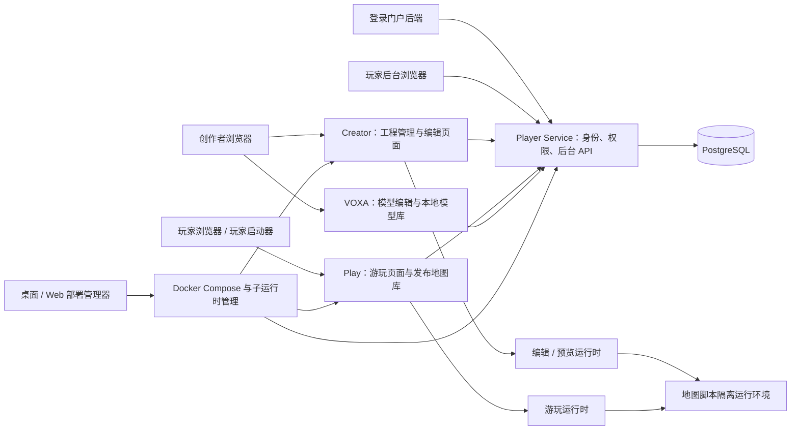

# 架构指南

BOX3 本地引擎是一个 Rush 工作区。Creator、Play 和 Player Service 使用 `apps/game` 的网页与 HTTP 服务代码，但运行模式、入口和构建产物不同；权威游戏状态与地图脚本运行在 `services/game-server`。部署管理器负责启动服务，玩家启动器负责连接服务。

## 服务如何连接

下图展示职责关系。源码开发在宿主机上启动进程；发行部署通过 Docker 启动服务和受控地图子运行时。图中的数据库和内部运行时地址是服务间连接，不是玩家需要填写的地址。

浏览器通过 Creator 或 Play 的同源入口请求会话、资源和 WebSocket；网页服务把这些请求转给内部运行时。不要直接公开运行时控制端口。源码默认地址见[开发入门](./developer-guide.md)，部署前缀与公开地址由配置和 `@box/deployment-routing` 统一计算。

Player Service 使用 PostgreSQL 保存玩家账号、管理账号、权限、封禁和审计。Redis 是可选的会话、限流和构建缓存后端；不连接 Redis 的单机配置使用内存或文件回退。地图脚本 storage 具有自己的存储实现和命名空间，不能用它的文件回退代替玩家身份数据库。

## 目录与职责

| 目录                                                              | 负责什么                                               | 建议先读                                                           |
| ----------------------------------------------------------------- | ------------------------------------------------------ | ------------------------------------------------------------------ |
| `apps/game`                                                       | Creator/Play/Player Service 的网页、HTTP API 与转发    | `pages/projects/index.tsx`、`server/`、`src/views/edit/`           |
| `apps/local-engine`                                               | 工程创建、快照、导入导出、发布、地图库、运行时生命周期 | `src/project-manager.js`、`src/play-library.js`、`src/launcher.js` |
| `services/game-server`                                            | 权威实体和体素状态、会话、脚本执行、storage、反作弊    | `src/launch.ts`、`src/session/`、`src/storage/`、`src/anticheat/`  |
| `apps/voxa`                                                       | 体素模型、皮肤、动画编辑和本地模型存储                 | [模块说明](../apps/voxa/README.md)                                 |
| `apps/player-admin`                                               | 玩家、权限、游玩地图与运行时管理界面                   | [模块说明](../apps/player-admin/README.md)                         |
| `apps/player-auth-portal`                                         | 登录/注册/账号设置的参考门户；后端连接 Player Service  | [模块说明](../apps/player-auth-portal/README.md)                   |
| `apps/deployment-manager`                                         | 桌面与 Web 共用管理界面；Tauri 桌面适配                | [模块说明](../apps/deployment-manager/README.md)                   |
| `apps/server-manager-rust`                                        | Web 管理 HTTP、认证、Docker 和文件系统适配             | [模块说明](../apps/server-manager-rust/README.md)                  |
| `apps/manager-core`                                               | 两种管理器共用的配置、服务和备份规则                   | [模块说明](../apps/manager-core/README.md)                         |
| `apps/player-launcher`                                            | Electron 玩家客户端、服务器连接、本机缓存              | [模块说明](../apps/player-launcher/README.md)                      |
| `internals/apis`                                                  | HTTP 契约、OpenAPI 与生成客户端                        | [模块说明](../internals/apis/README.md)                            |
| `internals/schema`                                                | 场景、协议与基础脚本类型                               | `project/`、`api/js/api.ts`                                        |
| `packages/script-api`                                             | 本地引擎增加和覆盖的脚本 API 声明                      | `src/server/modules/`                                              |
| `packages/player-policy`、`realtime-client`、`deployment-routing` | 共享授权策略、实时连接和地址处理                       | 各包入口与测试                                                     |
| `scripts`、`distribution`                                         | 根任务、工程检查、打包和发行模板                       | `repo-tasks.js`、[发布说明](./release-and-version.md)              |

`internals/` 还包含建模、渲染、schema 与构建工具。它不是可以随意跨目录导入的全局工具箱：共享能力通过包入口使用，生成文件按契约维护。旧平台代码和嵌套示例不能自动视为主工作区支持的功能。

## 核心术语

| 名称               | 含义                                                                     |
| ------------------ | ------------------------------------------------------------------------ |
| 工程 / project     | Creator 中可编辑的一张地图及其源状态、资源与本地版本                     |
| 地图组             | 一个主地图与零到多个副地图；成员有独立地形和实体，共享组资源和组数据空间 |
| 工程 ID            | Creator 内定位工程的 ID，导入工程时可能重新分配                          |
| 永久地图 ID        | 稳定地图标识；运行时和存储使用它，修改访问 ID 不会改变它                 |
| 访问 ID / publicId | 用户入口 `/p/<publicId>` 中可修改的短名称                                |
| blob               | 按内容哈希定位的资源或序列化数据；不是所有 blob 都适合公开分发           |
| 快照 / release     | 某次发布保存的不可变地图状态，后续编辑不会自动修改它                     |
| `.boxproject`      | 可重新导入 Creator 的可编辑工程或地图组备份                              |
| `.boxplay`         | 供 Play 导入的已发布地图组包，不含可编辑 `source/`                       |
| 会话 / session     | 某个已认证玩家连接指定运行时的临时授权，与管理登录不同                   |
| owner / 服主       | 通过 `BOX_PLAY_ADMIN_TOKEN` 初始化与管理后台的最高管理身份               |
| 管理员             | 服主创建的独立管理账号，权限由权限组决定；不是普通玩家账号               |
| 创作者             | 获得 Creator 访问和相应创作能力的玩家账号；注册不会自动授予这些能力      |

## 从编辑到游玩的数据流

1. 服主创建管理账号和权限组，给测试玩家授予创作能力。登录门户通过服务端认证 API 建立玩家登录，浏览器不持有认证 API 密钥。
2. Creator 创建工程，编辑运行时接收场景、体素和脚本修改；VOXA 保存的模型资源通过本地适配加入工程。
3. 预览启动该工程的游戏状态与脚本。导出 `.boxproject` 用于继续编辑、迁移和备份。
4. “导出游戏包”先发布地图组不可变版本，再生成 `.boxplay`。选择“仅本地资源”时包内携带所需资源；选择 OSS 时依赖发布者的资源地址。
5. 服主或有权管理员在玩家后台预览包中的脚本和媒体、确认导入、开放地图组。Player Service 的管理接口转发到 Play 地图库，Play 按发布快照启动运行时。
6. 玩家登录并访问 Play 地图入口，获得会话后连接同源 WebSocket。服务器维护权威状态；客户端显示和输入不能代替服务端权限检查。

完整操作见[首个作品教程](./first-project.md)。修改作品格式时同时检查 Creator 导出、Play 导入、资源引用和旧格式迁移；修改权限时同时检查客户端展示、服务端鉴权和运行时断言，具体测试见[测试指南](./testing.md)。

## 持久化与运行边界

源码的作品和资源在 `apps/local-engine/projects/`、`play-worlds/`、`data/`，VOXA 的数据在 `apps/voxa/data/`；身份和管理记录在 PostgreSQL。桌面发行使用系统应用数据目录，不能假设它与源码目录共享数据。

作品包不是数据库备份，管理器的数据备份也不能替代外部 PostgreSQL/Redis 的备份。Creator/VOXA 只用于本机或可信内网；公网游玩需要正确配置公开地址、登录策略、HTTPS 与可信代理。内部密钥、用户数据、运行目录和生成产物不属于公开源码素材。
