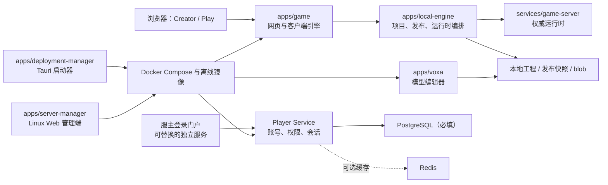

# BOX3 Engine 系统架构与源码入口

本文帮助协作者快速判断一个需求应该改到哪里。它描述当前仓库的实现边界；部署命令和服主配置请看[文档导航](./README.md)。

## 整体关系



Creator 读取可编辑工程；Play 只读取发布后的只读快照。这条边界不能被“隐藏按钮”替代：Play 不能获得 Creator 的工程写入能力或源目录挂载。

桌面启动器不在上述请求链路中。它只在宿主机侧写配置、导入离线镜像并调用 Docker Compose；业务容器不依赖桌面窗口保持打开。无桌面 Linux 服务器可运行独立 Web 管理容器，它只允许管理 Play、Player Service 与登录门户。该容器拥有 Docker Socket 的 root-equivalent 权限，因此默认仅监听回环地址，并使用独立管理令牌与固定操作白名单。

## 服务职责

| 服务             | 对外职责                                  | 主要源码入口                                                            | 关键约束                                      |
| ---------------- | ----------------------------------------- | ----------------------------------------------------------------------- | --------------------------------------------- |
| Creator          | 作品中心、地图编辑、预览、发布            | `apps/game/`、`apps/local-engine/src/project-manager.js`                | 只限本机或可信局域网，不可公网暴露            |
| Play             | 玩家作品中心、运行已发布地图              | `apps/game/`、`apps/local-engine/src/play-library.js`                   | 仅读取发布包，不读取工程源目录                |
| VOXA             | 模型、皮肤、动画工程编辑                  | `apps/voxa/`                                                            | 项目内资源与全局模型库必须隔离                |
| Player Service   | 玩家身份、角色、封禁、会话和服主管理      | `apps/local-engine/src/launcher.js`、`services/game-server/src/player/` | PostgreSQL 是正确性来源；管理员和服主权限不同 |
| 登录门户         | 登录/注册网页与服务端代理                 | `examples/player-auth-portal/`                                          | 可由服主自建；API Key 绝不能进入浏览器        |
| 内部迁移工具     | 将外部工程转为本地可编辑工程              | `apps/migrator/`                                                        | 不进入用户发行包；失败要保留资源缺失上下文    |
| 部署管理器       | 图形化配置、Docker 控制、备份和离线包导入 | `apps/deployment-manager/`                                              | 服主 `.env` 与自动生成的 `.runtime.env` 分离  |
| Linux Web 管理端 | 无桌面服务器状态、日志、配置与启停        | `apps/server-manager/`                                                  | 仅三项游玩服务；默认 localhost；固定命令      |

## 核心数据模型

### 地图与发布

1. 每个可编辑作品有独立项目目录和不可变 `mapUuid`。
2. 地图组由一个主地图和零到多个副地图组成；它们共享组身份，但各自保存项目状态。
3. 发布会生成只读快照；Play 导入、浏览和运行的是该快照，而不是工程源码。
4. 地图、模型和脚本依赖 blob hash。导入时必须保留依赖或报告不可恢复的缺失资源，不能让空 hash 阻塞整张地图启动。

### 脚本与共享资源

地图组同时包含“地图自身工程内容”和“共享资源库”：

- 入口脚本与普通脚本属于当前地图工程，随地图的 `project.scriptAssets` 保存；它们可以使用共享资源，但不因为共享库刷新而变成共享脚本。
- 标记为共享的脚本、模型、皮肤、UI、图片和音频位于地图组 Shared Resource Library，成员地图会读取同一份引用。
- 云端迁移工程的普通脚本仍是地图自身脚本。编辑器文件树在刷新共享资源快照时只能删除已移除的共享脚本，不能删除不在共享库中的普通迁移脚本。

因此，看到“只有入口脚本”通常不是脚本丢失，而是编辑器读取或同步范围错误；修复时应检查 `services/game-server/src/edit/code-editor/` 的文件树同步，而不是修改发布 blob 或强行复制脚本到共享库。

### 客户端脚本与服务端脚本

两类脚本共享工程文件管理，但信任级别不同：

| 类型       | 执行位置                          | 编辑器声明                                       | 安全定位                                                      |
| ---------- | --------------------------------- | ------------------------------------------------ | ------------------------------------------------------------- |
| 客户端脚本 | Creator/Play 的玩家浏览器页面     | 引擎客户端 API，加常用 DOM、网络、媒体和输入类型 | 不可信；玩家可以查看或篡改，不得持有秘密或决定权威业务结果    |
| 服务端脚本 | game-server 的 isolated-vm 运行时 | 服务端引擎 API 与本地平台声明                    | 权威逻辑所在；仍受内存、生命周期、输入校验和公开 API 边界约束 |

Monaco 的 DTS 只控制代码补全和类型提示，不会改变浏览器运行时，也不是能力沙箱。客户端脚本可以使用
页面实际提供的浏览器全局对象；安全设计不能依赖“DTS 中没有声明某个名字”。相反，服务端不能为了兼容
客户端脚本而暴露 Node.js、数据库连接或宿主机文件系统。

脚本 URL 接口共用 `packages/utils/src/safe-url.ts` 的协议校验：接受任意域名的绝对 HTTP(S) URL，
拒绝脚本/文件协议、控制字符和 URL 凭据。该规则与登录 Origin、登录回跳和资源 CORS 分开维护。
客户端最终还受浏览器同源策略与目标服务器 CORS 约束。

详细约束见[地图存储 UUID 决策](./adr/0001-stable-map-storage-identity.md)和[作品与发布包](./projects.md)。

### 模型工程

VOXA 的新 `.voxaproject` 导出包包含工程文件、模型元数据、模型数据和预览依赖。旧工程包可能只含工程文件；导入后需要在原 VOXA 打开并重新保存再导出，不能凭空恢复不存在的 blob。

### 配置与秘密

- `.env`：服主可编辑的持久配置与密钥。
- `.runtime.env`：启动器在启动前派生的内部 URL、CORS、镜像标签和端口绑定；不应手工维护。
- PostgreSQL：身份、权限和持久数据的正确性来源。
- Redis：可选缓存与跨实例能力；未配置时功能必须有安全回退。

配置的权威来源和桌面启动器生成规则见[配置参考](./configuration-reference.md)。不要让业务代码直接依赖启动器 `.runtime.env` 的存在；源码 Compose 和测试必须仍能从普通 `.env` 工作。

## 从需求定位到代码

| 需求类型                         | 优先阅读 / 修改的位置                                                         | 必做验证                                       |
| -------------------------------- | ----------------------------------------------------------------------------- | ---------------------------------------------- |
| Creator 或 Play 页面、卡片、交互 | `apps/game/pages/`、`apps/game/components/`                                   | 对应页面 smoke test；Creator/Play 产物隔离检查 |
| 地图创建、导入、发布、地图组     | `apps/local-engine/src/project-manager.js`、`map-group-manager.js`            | 工程创建、导入、保存、发布、Play 重新导入      |
| 运行时启动、锁、预热、会话       | `apps/local-engine/src/runtime-*.js`、`services/game-server/src/`             | 生命周期、锁超时和地图启动回归                 |
| 玩家、权限、封禁、认证 API       | `services/game-server/src/player/`、`docs/player-service-api.md`              | 无 Key、错误 Key、权限越界、封禁和会话撤销     |
| VOXA 模型与工程包                | `apps/voxa/`、`apps/game/components/creator-model-library.tsx`                | 导出、导入、预览、地图内放置                   |
| Docker、端口和环境变量           | `docker-compose.yml`、`apps/deployment-manager/src-tauri/src/config.rs`       | `docker compose config --quiet`、配置校验      |
| 图形化启动器                     | `apps/deployment-manager/src/main.js`、`src/styles.css`、`src-tauri/src/`     | Tauri build、桌面管理器检查、亮/暗主题状态     |
| Linux Web 管理端                 | `apps/server-manager/`、`distribution/server/`                                | 模块测试、Compose 校验、SSH 隧道访问           |
| 离线包和 CI                      | `scripts/build-desktop-offline-installer.js`、`.github/workflows/release.yml` | `pnpm verify`、离线包验证                      |

## 一次请求如何流动

### 创作者保存地图

```text
浏览器 Creator
  → apps/game 的编辑器客户端
  → Creator 控制层（项目状态、运行时生命周期、资源库）
  → services/game-server 编辑副本与脚本文件树
  → 项目 source/blob 与可选 PostgreSQL 数据空间
```

地图保存失败时，先区分是浏览器同源/CORS、Creator 控制层的项目锁、game-server 副本、宿主机目录权限，还是 PostgreSQL。不要直接重试或删除工程状态文件。

### 玩家进入地图

```text
浏览器 Play
  → Play 图库读取已发布快照
  → Player Service 校验登录与封禁
  → Play 控制层取得/复用运行时
  → services/game-server 权威运行时
  → 发布快照 blob、可选 PostgreSQL、可选 Redis
```

Play 进入失败时，发布清单、资源 blob 和运行时启动日志优先于前端提示。Play 不应该读取 Creator `source/`；若依赖缺失，应在导入/发布阶段报告 hash 与资源类型。

## 兼容边界

以下内容是外部兼容接口，修改前先阅读[boxes 对齐基线](./boxes-parity.md)，并添加明确回归：

- 地图 UUID、地图组关联与数据表命名；
- blob/hash 资源引用和发布快照结构；
- 游戏脚本 API、运行时协议和消息顺序；
- Creator 编辑、保存、预览与 Play 运行的边界；
- 导入外部地图或模型时的资源依赖解析。

本地化能力（Docker、离线包、部署管理器、本地玩家服务、远程 PostgreSQL/Redis）可以独立演进，但不得破坏上述兼容接口。
