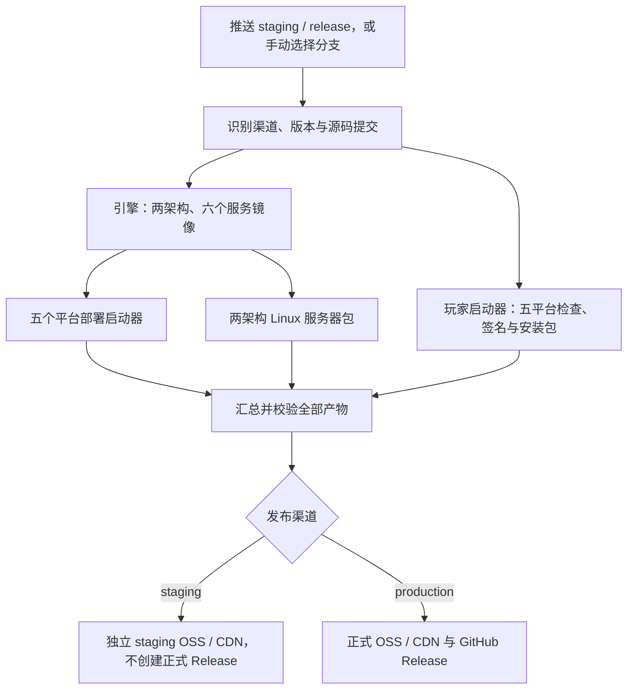

# 发布与版本

`staging` 和 `release` 共用同一套构建、校验、签名、打包与汇总流程。引擎使用 `release.yml`，玩家启动器使用 `player-launcher-release.yml`；没有单独的测试打包流程。

## 一套流程，两个渠道



两条产品流水线独立完成汇总；上图展示共同阶段。PR、`dev` 和 `main` 的 Verify 只检查格式、语法和代码风格，不打包。正式发布要求通过 PR 合入 `release`，成功后由维护者同步 `main`。

## 版本与文件名

| 内容       | 正式示例                                       | 预发布示例                                             |
| ---------- | ---------------------------------------------- | ------------------------------------------------------ |
| 引擎版本   | `0.3.0`                                        | `0.3.0-staging`                                        |
| 部署启动器 | `BOX-Local-Engine-0.3.0-macos-arm64.zip`       | `BOX-Local-Engine-0.3.0-staging-macos-arm64.zip`       |
| Linux 包   | `BOX3-Engine-Server-0.3.0-linux-arm64.zip`     | `BOX3-Engine-Server-0.3.0-staging-linux-arm64.zip`     |
| 镜像标签   | `v0.3.0-linux-arm64`                           | `v0.3.0-staging-linux-arm64`                           |
| 玩家版本   | `0.1.0`                                        | `0.1.0-staging`                                        |
| 玩家安装包 | `BOX3-Player-Launcher-0.1.0-windows-amd64.exe` | `BOX3-Player-Launcher-0.1.0-staging-windows-amd64.exe` |

预发布后缀属于实际应用版本，不只是 ZIP 名称。流水线在临时构建工作区准备版本，无需把源码版本手工改成 staging，也不创建 staging Git Tag。正式 Tag 仍由流水线固定为 `v<引擎版本>` / `player-v<玩家版本>`。

引擎版本取根 `package.json`，后续使用 `YYYY.N.P`；玩家版本取自身 `package.json`。一个正式版本只能对应一个提交。

## OSS 与更新隔离

| 内容               | 正式目录                                   | 预发布目录                                                     |
| ------------------ | ------------------------------------------ | -------------------------------------------------------------- |
| 引擎镜像和构建产物 | `local-engine/v<版本>/`                    | `local-engine-staging/v<版本>-staging/<commit>/`               |
| 部署启动器         | 上述目录的 `desktop-lightweight-<commit>/` | 同样的子目录规则                                               |
| 引擎分发与 latest  | `local-engine/`                            | `local-engine-staging/`                                        |
| 玩家安装包         | `box-player-launcher/player-v<版本>/`      | `box-player-launcher-staging/player-v<版本>-staging/<commit>/` |

预发布镜像清单固定到源码提交，安装包使用 staging 镜像和更新地址，不回退到正式目录。预发布桌面程序使用独立应用标识、数据目录和容器项目；在独立测试环境运行，业务端口配置与正式环境一致。

同一提交重跑可复用缓存；新的 staging 提交使用新目录，不会借用旧提交镜像。手动运行引擎工作流并勾选 `rebuild_images` 可强制重建该 staging 提交的镜像和部署启动器。更新提示按版本比较，同基础版本的新 staging 包可手动下载安装。

## 维护者操作

| 步骤     | 操作                                                                    |
| -------- | ----------------------------------------------------------------------- |
| 准备     | 更新引擎和玩家版本，同步版本文件，完成基础检查                          |
| 模拟发布 | 推送 `staging`，查看两条工作流的全部目标与汇总任务                      |
| 业务验收 | 下载 staging 包，检查安装、登录、地图、备份与更新；核对版本、架构和提交 |
| 正式发布 | 通过 PR 合入 `release`，检查正式 Release 与 CDN 产物                    |
| 升级     | 同步 `main`；保留 `.env`、作品和数据库备份，再部署                      |

版本更新示例，仓库根目录执行，数字按本次发行替换：

```sh
npm version 2026.1.0 --no-git-tag-version
node scripts/sync-root-version.js
npm --prefix apps/player-launcher version 0.1.1 --no-git-tag-version
npm run version:check
npm run verify
```

正式失败后，同一提交可重跑；需要修改源码或签名时使用新版本和新 PR，不移动旧 Tag。回滚前确认旧镜像与数据格式兼容。

## 配置入口

在 Actions Secrets 配置 `ALIYUN_OSS_BUCKET`、`ALIYUN_OSS_ENDPOINT`、`ALIYUN_OSS_ACCESS_KEY_ID` 和 `ALIYUN_OSS_ACCESS_KEY_SECRET`。Bucket 仅填名称，Endpoint 不带协议或路径。CDN 需能读取新增的两个 staging 目录。

| 流水线               | 配置                                                                            |
| -------------------- | ------------------------------------------------------------------------------- |
| 引擎预发布与正式发布 | [release.yml](../.github/workflows/release.yml)                                 |
| 玩家预发布与正式发布 | [player-launcher-release.yml](../.github/workflows/player-launcher-release.yml) |
| 基础检查             | [verify.yml](../.github/workflows/verify.yml)                                   |
| 正式 Linux 包补打    | [package-server.yml](../.github/workflows/package-server.yml)，复用正式应用镜像 |

玩家签名与平台验收见[玩家发布说明](../apps/player-launcher/docs/release.md)，详细手动测试见[检查与测试](testing.md)。
