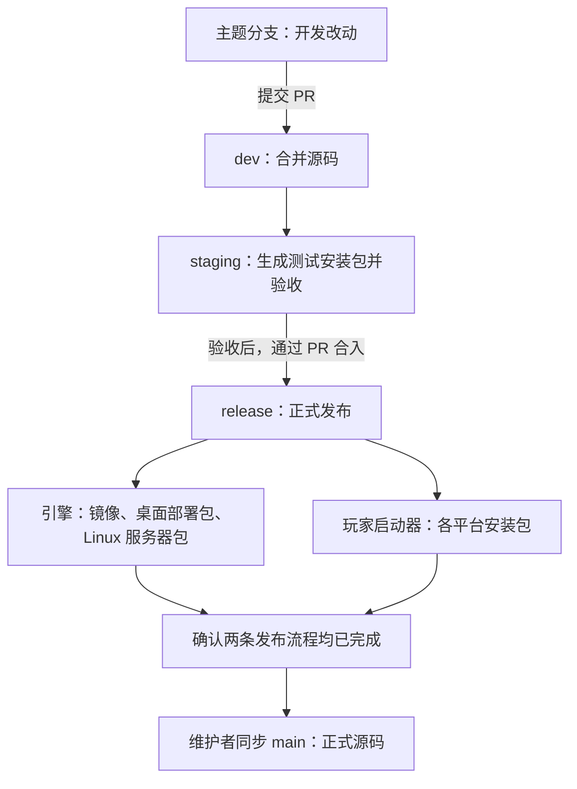
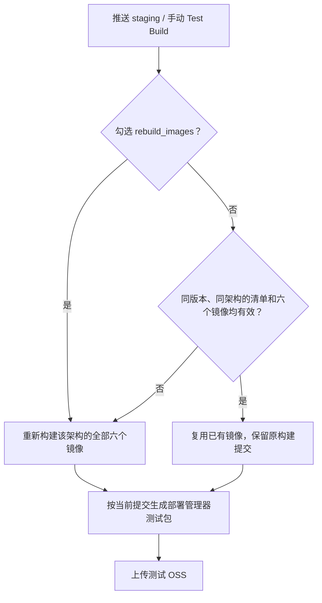

# 发布与版本

开发改动先进入 `dev`，在 `staging` 验收，再通过 PR 合入 `release` 发布。引擎与玩家启动器分别维护版本、分别构建；两条发布流程确认完成后，由维护者同步 `main`。

## 发布流程



| 入口              | 自动执行什么                               | 是否发布                      |
| ----------------- | ------------------------------------------ | ----------------------------- |
| PR、`dev`、`main` | Verify：格式、语法和代码风格检查           | 不打包、不上传                |
| 更新 `staging`    | 构建引擎测试包和玩家测试包                 | 仅上传测试 OSS                |
| 手动 Test Build   | 在 `staging` 重跑，可勾选 `rebuild_images` | 仅上传测试 OSS                |
| PR 合入 `release` | 校验合并来源、版本和配置，构建正式产物     | GitHub Release 与正式 OSS/CDN |

**无需手动打 Tag。** 正式流水线在构建前固定版本标签；测试不创建发布标签，也不更新正式 `latest`。直接推送 `release` 不能代替合并 PR 的校验。

## 测试包为什么可能还是旧镜像

`staging` 的镜像缓存按**引擎版本 + CPU 架构**复用；部署管理器安装包按当前提交重新生成。



| 你修改了什么                   | 如何测试                                              |
| ------------------------------ | ----------------------------------------------------- |
| 部署管理器界面或逻辑           | 直接使用新的 `staging` 测试包                         |
| Creator、VOXA、Play 等引擎服务 | 升级引擎版本，或手动 Test Build 勾选 `rebuild_images` |
| 玩家启动器                     | 使用玩家测试包，版本带 `dev.<run-id>.<attempt>`       |
| 仅调试源码行为                 | 启动本地开发栈，按需运行相关模块测试                  |

例如：同版本修改 VOXA 后推送 `staging`，缓存有效时仍会使用旧 VOXA 镜像。验收时同时核对**安装包提交、镜像清单中的构建提交、平台与架构**。强制重建会保留旧内容归档，已有测试包仍可下载其固定镜像。

## 正式发布：维护者操作

| 步骤          | 操作                                                      | 完成标志                       |
| ------------- | --------------------------------------------------------- | ------------------------------ |
| 1. 准备版本   | 更新引擎和玩家启动器版本，提交版本同步文件                | 两个版本均可用于本次提交       |
| 2. 测试验收   | 在 `staging` 检查启动、登录、地图导入与游玩，以及本次改动 | 使用的镜像与安装包来源符合预期 |
| 3. 合入发布   | 通过 PR 合入 `release`                                    | 两条正式流水线开始执行         |
| 4. 确认结果   | 查看全部平台任务、Release 附件和 OSS/CDN 文件             | 所需产物全部发布成功           |
| 5. 同步与升级 | 维护者同步 `main`；部署前备份配置、数据库和作品           | 升级后服务与数据正常           |

版本更新示例，在仓库根目录执行；示例版本需按本次发行替换：

```sh
npm version 2026.1.0 --no-git-tag-version
node scripts/sync-root-version.js
npm --prefix apps/player-launcher version 0.1.1 --no-git-tag-version
npm run version:check
npm run verify
```

`verify` 只做基础检查；功能与目标平台验收按本次改动另行执行。检查版本差异后提交，再创建发布 PR。玩家启动器的签名与平台要求见[玩家发布说明](../apps/player-launcher/docs/release.md)。

## 版本与重跑规则

| 对象或情况               | 规则                                                                                                            |
| ------------------------ | --------------------------------------------------------------------------------------------------------------- |
| 引擎版本                 | 取根 `package.json`；后续采用 `YYYY.N.P`，例如 `2026.1.0`。年份按上海时区，当年功能序号从 1 开始，补丁从 0 开始 |
| 玩家启动器版本           | 取 `apps/player-launcher/package.json`，独立维护                                                                |
| 公共包版本               | 按各包 API 兼容性升级，不随引擎统一改号；依赖更新见[开发入门](developer-guide.md)                               |
| 正式标签                 | 引擎 `v<引擎版本>`；玩家启动器 `player-v<玩家版本>`                                                             |
| 正式构建失败，提交未变   | 可重跑，复用有效缓存                                                                                            |
| 正式构建失败，需要改代码 | 使用新版本、新提交和新的发布 PR；不移动旧 Tag                                                                   |
| 测试构建失败             | 可同版本重跑，必要时强制重建镜像                                                                                |
| 回滚                     | 同时确认旧镜像与现有数据是否兼容；涉及不可逆迁移时使用发布前备份                                                |

**一个正式版本只能对应一个提交。** 合入 `release` 会同时启动引擎和玩家启动器发布，两者版本都要检查。

## 发布配置速查

<details>
<summary>展开：OSS 路径与密钥配置</summary>

| 产物                 | OSS 路径                                                                |
| -------------------- | ----------------------------------------------------------------------- |
| 引擎测试镜像         | `local-engine-testing/v<引擎版本>/`，标签为 `test-v<版本>-linux-<架构>` |
| 部署管理器测试包     | `local-engine-testing/v<引擎版本>/launchers/<commit>/`                  |
| 玩家启动器测试包     | `box-player-launcher-testing/<commit>/<run-id>-<attempt>/`              |
| 引擎正式中间产物     | `local-engine/v<引擎版本>/`                                             |
| 引擎正式分发入口     | `local-engine/`                                                         |
| 玩家启动器正式安装包 | `box-player-launcher/player-v<玩家版本>/`                               |

部署管理器测试包通过测试目录下载镜像，不回退到正式镜像；`assets.box3.fun` CDN 需能读取 `local-engine-testing/`。桌面部署包和玩家安装包各覆盖五个目标：Windows x64 / ARM64、macOS ARM64、Linux x64 / ARM64；引擎镜像为 Linux AMD64 / ARM64。

在官方仓库的 Actions Secrets 配置：

- `ALIYUN_OSS_BUCKET`：仅 Bucket 名称。
- `ALIYUN_OSS_ENDPOINT`：仅主机名，不带协议或路径。
- `ALIYUN_OSS_ACCESS_KEY_ID`、`ALIYUN_OSS_ACCESS_KEY_SECRET`：访问凭据。

Fork PR 无需配置发布密钥。密钥不写入源码、文档或公开日志。

</details>

| 流水线                  | 配置文件                                                                                                                                                                |
| ----------------------- | ----------------------------------------------------------------------------------------------------------------------------------------------------------------------- |
| 基础检查                | [verify.yml](../.github/workflows/verify.yml)                                                                                                                           |
| 引擎测试 / 正式发布     | [test-build.yml](../.github/workflows/test-build.yml) / [release.yml](../.github/workflows/release.yml)                                                                 |
| 玩家测试 / 正式发布     | [player-launcher-test-build.yml](../.github/workflows/player-launcher-test-build.yml) / [player-launcher-release.yml](../.github/workflows/player-launcher-release.yml) |
| 单独补打 Linux 服务器包 | [package-server.yml](../.github/workflows/package-server.yml)，复用已发布的应用镜像，仅构建 Web 管理器镜像                                                              |

基础检查范围见[测试指南](testing.md)，贡献流程见[贡献指南](../CONTRIBUTING.md)。
